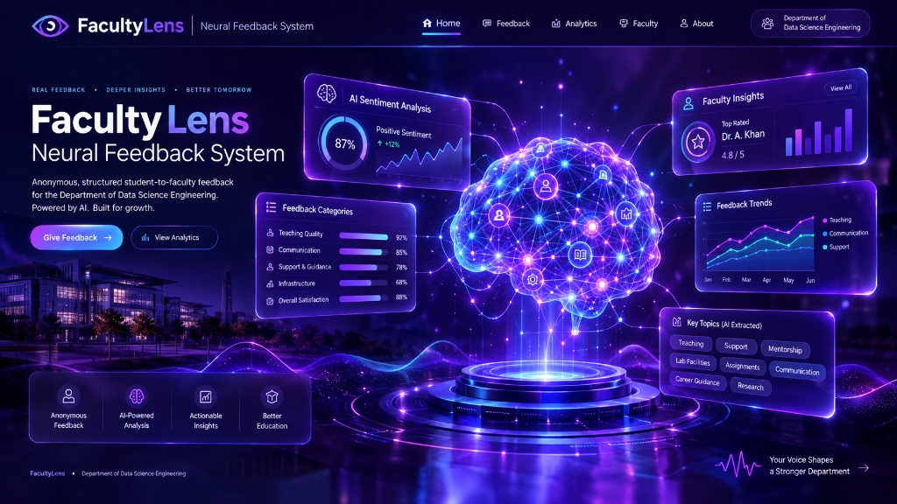

<div align="center">

  # 🎓 FacultyLens — Neural Feedback System
  ### *Anonymous, Structured Student-to-Faculty Feedback Platform for Data Science Engineering*

  [](https://github.com/SyedAynan/Neural-Feedback/actions/workflows/php-lint.yml)
  
  
  
  

  <p align="center">
    <b>Empowering students and faculty with transparent, role-based analytics, sentiment metrics, and real-time performance insights.</b>
  </p>

  

</div>

## 📜 Table of Contents
- [✨ Features](#-features)
- [🧰 Tech Stack](#-tech-stack)
- [⚡ Quick Start & Deployment](#-quick-start--deployment)
- [🔑 Demo Credentials](#-demo-credentials)
- [🔌 API Endpoints](#-api-endpoints)
- [🗄️ Database Schema](#-database-schema)
- [🔒 Security & Code Quality](#-security--code-quality)
- [🎨 Design System](#-design-system)
- [📝 License](#-license)

---

## ✨ Features

| Area | Feature Details | Path / Location |
|---|---|---|
| 🔐 **Role-Based Auth** | Secure login & registration supporting **Student**, **Faculty**, **Admin**, and **HoD** roles with bcrypt password hashing | `FRONTEND/index.html` & `FRONTEND/signup.html` |
| 📊 **Analytics Dashboard** | Live statistical metrics, radar rating charts, and feedback distribution trends | `FRONTEND/dashboard.html` |
| 🧑‍🏫 **Faculty Directory** | Interactive faculty profiles, teaching portfolios, and structured feedback forms | `FRONTEND/Faculties/` |
| ⚖️ **Faculty Compare** | Side-by-side comparative evaluation tool for clarity, knowledge, and interaction metrics | `FRONTEND/compare.html` |
| 🏆 **Leaderboard** | Podium-ranked faculty leaderboard based on verified student feedback averages | `FRONTEND/leaderboard.html` |
| ⭐ **Submit Feedback** | Multi-attribute rating system (1–10 scale) covering clarity, subject depth, and engagement | `FRONTEND/essentials/submit-feedback.html` |
| 📈 **Student Reports** | Personal submission history and visual progress tracker | `FRONTEND/essentials/report.html` |
| 🛠️ **Admin Control Panel** | System controls, user management, feedback audit logs, and data management | `FRONTEND/admin.html` |
| 🔑 **Password Recovery** | Forgot-password workflow with OTP recovery interface | `FRONTEND/forgot-password.html` |
| 📤 **Data Export** | CSV export capabilities & print-friendly report generation | Admin & Dashboard tools |
| 🚫 **Custom 404** | Glassmorphic theme-matched not-found fallback page | `404.html` |

---ultyLens feedback system, neon dark theme, crisp glassmorphism aesthetic, studio lighting --ar 16:9`

---

## 🧰 Tech Stack

- **Frontend**: Vanilla HTML5, Modern CSS3 (Glassmorphism design system in `FRONTEND/theme.css`), JavaScript (ES6+), Google Font (Poppins), SVG & CSS chart engines.
- **Backend**: PHP 8.x with prepared statements and session authentication (`BACKEND/`, `API/`).
- **Database**: MySQL / MariaDB relational database (`DATABASE/schema.sql`).
- **Environment**: Apache / XAMPP / WAMP / Nginx deployment.

---

## ⚡ Quick Start & Deployment

### Prerequisites
- **XAMPP** (or any Apache + PHP 8 + MySQL stack)
- Modern Web Browser

### 1. Clone & Copy to Web Root
```bash
git clone https://github.com/SyedAynan/Neural-Feedback.git
# Copy into XAMPP htdocs:
cp -r Neural-Feedback/ C:/xampp/htdocs/facultylens/
```

### 2. Import Database Schema
Import `DATABASE/schema.sql` via MySQL CLI or phpMyAdmin:
```bash
mysql -u root < DATABASE/schema.sql
```

### 3. Environment Setup
```bash
cp .env.example .env
# Edit .env with your MySQL credentials (DB_HOST, DB_USER, DB_PASS, DB_NAME)
```

### 4. Open in Browser
Navigate to:
```
http://localhost/facultylens/FRONTEND/index.html
```

---

## 🔑 Demo Credentials

| Role | Email | Password |
|---|---|---|
| 🛠️ **Admin** | `admin@facultylens.edu` | `admin123` |
| 🎓 **Student** | `student@facultylens.edu` | `student123` |

> *Note: The login page includes a standalone **Demo Mode** for frontend previews without needing Apache/PHP.*

---

## 🔌 API Endpoints

| Method | Endpoint | Description |
|---|---|---|
| `POST` | `API/register.php` | Account creation with role validation & bcrypt hashing |
| `POST` | `API/login.php` | Credential verification & session initialization |
| `POST`/`GET` | `API/logout.php` | Session destruction |
| `POST` | `API/feedback.php` | Submit rated feedback (clarity, depth, interaction, comments) |
| `POST` | `API/change-password.php` | Secure session password update |
| `GET` | `API/rating.php` | Fetch teacher rating averages & feedback counters |

---

## 🗄️ Database Schema

```
DATABASE/schema.sql
├── users (id, name, email, password, role, username, created_at)
├── faculty (id, name, designation, department, subject, email, photo, qualification, experience, expertise)
└── feedback (id, user_id, faculty_id, teacher, subject, clarity, knowledge, interaction, comment, sentiment, timestamp)
```

---

## 🔒 Security & Code Quality

- **Password Hashing**: `password_hash()` and `password_verify()` with bcrypt.
- **SQL Injection Prevention**: Prepared statements on all database queries.
- **Session Protection**: Route guards in `BACKEND/auth.php`.
- **Environment Isolation**: `.env` file for credentials (gitignored).

---

## 📝 License

This project is open-source under the **MIT License**. Created for the **Department of Data Science Engineering**.

---

<div align="center">
  <sub>Maintained with ❤️ by <b>SyedAynan / Neural-Feedback</b></sub>
</div>
